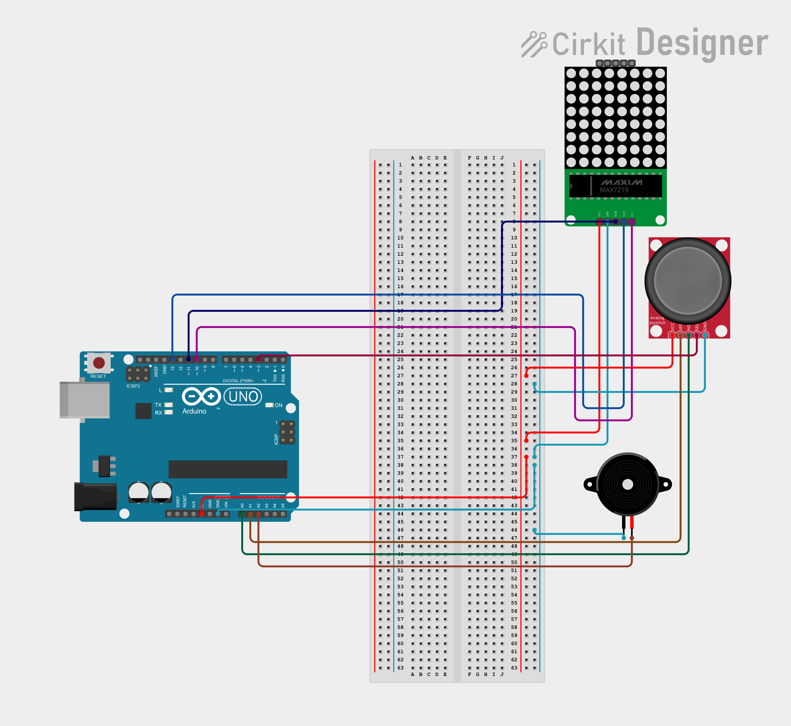

# Focus Timer

Focus Timer is an Arduino-based timer built with an Arduino Nano, a 32×8 MAX7219 LED matrix, a joystick, and a buzzer.

It lets the user select a preset duration, control the countdown using the joystick, and receive an audible notification when the timer finishes.

## Features

- 5, 10, 15, and 20-minute presets
- Countdown displayed on a 32×8 LED matrix
- Joystick controls
- Start, pause, resume, and reset
- Buzzer notification when the timer ends
- Sleep mode after inactivity

## Components

| Component | Quantity |
|---|---:|
| Arduino Nano | 1 |
| 32×8 MAX7219 LED matrix | 1 |
| Joystick module | 1 |
| Buzzer | 1 |
| Jumper wires | As needed |

## Wiring

### 32×8 MAX7219 LED Matrix

| Matrix pin | Arduino Nano |
|---|---|
| VCC | 5V |
| GND | GND |
| DIN | D11 |
| CS | D10 |
| CLK | D13 |

### Joystick

| Joystick pin | Arduino Nano |
|---|---|
| VCC | 5V |
| GND | GND |
| VRX | A0 |
| VRY | A1 |
| SW | D3 |

### Buzzer

| Buzzer pin | Arduino Nano |
|---|---|
| Positive | A2 |
| Negative | GND |

## Wiring Diagram

[Open the editable circuit in Cirkit Designer](https://app.cirkitdesigner.com/project/df783cec-c46b-44b2-bc0e-42a454f36963)

*The circuit diagram uses substitute symbols for the Arduino Nano and 32×8 matrix. Verify the connections against the actual hardware before treating the diagram as final.*

## Assembly

1. Connect the LED matrix to the Arduino Nano.
2. Connect the joystick to the Nano.
3. Connect the buzzer to A2 and GND.
4. Upload the Arduino sketch.
5. Power the circuit and select a timer preset using the joystick.
6. Press the joystick to start the countdown.

## How It Works

When the project starts, the LED matrix displays the timer interface. The joystick is used to select a preset duration and control the countdown.

The remaining time is displayed on the matrix. When the countdown reaches zero, the buzzer sounds to notify the user.

## Project Image

### Working Demo

[Watch the Focus Timer demo](20260930_141525.mp4)

## Hardware Design

The Focus Timer includes a 3D enclosure model and a simplified component-placement assembly created using Onshape.

### CAD Assembly Preview

### Onshape Workspace

### CAD Files

- [Focus Timer Assembly (STEP)](cad/Focus_Timer_Assembly.step)
- [Focus Timer Case (STL)](cad/Focus%20Timer%20Case.stl)
- [FreeCAD Project](cad/f.FCStd)
- [Enclosure STEP](cad/focus_timer_case-Focus_Timer_Case001.step)

### Assembly Components

The assembly shows the approximate placement of the following components:

- Arduino Nano
- 32×8 LED matrix
- Joystick module
- Buzzer module
- Enclosure

**Note:** The electronic components are simplified CAD placeholders. Their dimensions, mounting points, and physical fit have not yet been verified against the actual hardware.

### Design Goal

The enclosure and assembly help visualize the project's physical layout and plan component placement before final assembly.

## Libraries Used

- MD_Parola
- MD_MAX72XX
- SPI

## What I Learned

I learned how to control a MAX7219 LED matrix, read joystick inputs, and implement timer logic using an Arduino.

During development, I changed the display from my original four-digit seven-segment setup to a 32×8 LED matrix and joystick.

## Current Build

The project uses an Arduino Nano, a 32×8 LED matrix, a joystick, and a buzzer. The repository includes the wiring diagram, working demo, and enclosure model. The component-placement assembly is a simplified CAD representation intended to support enclosure planning and documentation.
